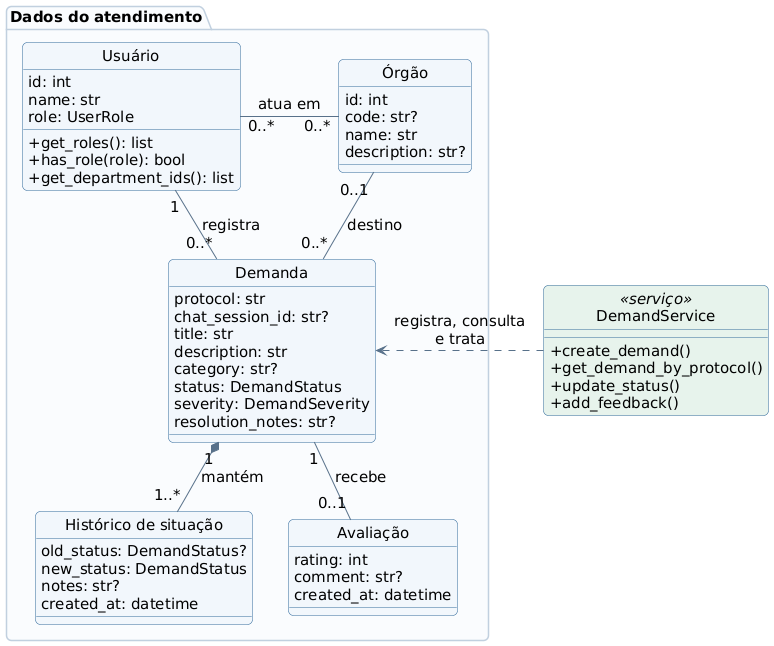

# GovResolve — Diagrama de Classes

**Foco:** entidades centrais, multiplicidades e operações reais. Revisado em 28/10/2026 para a versão local do protótipo; a diferença em relação ao GitHub está na [conferência](06_conferencia.md).

**Como explicar:** o usuário pode exercer vários papéis e atuar em vários órgãos. Cada demanda pertence a um cidadão, possui um destino opcional no modelo de dados, mantém histórico e pode receber uma avaliação. As operações de registro, atualização e avaliação pertencem a `DemandService`; as entidades ORM não implementam esses métodos.

| Nome no diagrama | Classe no código |
|---|---|
| Usuário | `User` |
| Órgão | `Department` |
| Demanda | `Demand` |
| Histórico de situação | `StatusHistory` |
| Avaliação | `Feedback` |

Os vínculos entre usuários e órgãos são mantidos por `user_departments`; os papéis adicionais, por `UserRoleAssignment`. O vínculo primário `User.department_id` foi preservado para compatibilidade com a versão publicada. Essas estruturas de apoio foram condensadas no desenho. A sessão fica em JSON por `SessionStore`; `Demand.chat_session_id` tem unicidade no banco, evitando dois protocolos para a mesma sessão. Demandas aprovadas para revisão humana podem permanecer sem órgão até o gestor atribuir o destino.

As operações aparecem com os parâmetros omitidos para leitura. Os atributos são uma seleção; `?` indica campo opcional. Estados: `ABERTO`, `EM ANDAMENTO` e `FECHADO`. Gravidade: `BAIXA`, `MEDIA`, `ALTA` ou `CRITICA`.
