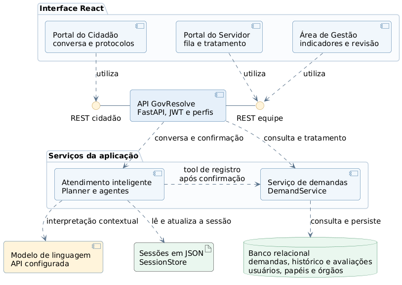

# GovResolve — Diagrama de Componentes

**Foco:** módulos ativos, interfaces HTTP e dependências da versão local do protótipo. Revisado em 28/10/2026; consulte a [conferência com o GitHub](06_conferencia.md).

**Como explicar:** os três ambientes usam a API. O atendimento inteligente monta a ficha e, depois da confirmação, usa `DemandRegistrationTool` para chamar `DemandService`. As conversas ficam em arquivos JSON; os registros e seus históricos ficam no banco relacional. Os círculos representam interfaces HTTP fornecidas pela API, não classes `IAtendimento` ou `ITratamento` existentes no código.

A autenticação e as dependências de autorização fazem parte da API. O login é demonstrativo, sem integração gov.br. A IA usa a API de modelo configurada. A revisão manual da Ouvidoria foi integrada à área de Gestão: o gestor consulta a fila sem órgão e atribui um destino pelas rotas administrativas. O envio de notificações por e-mail permanece removido.

| Interface fornecida | Rotas HTTP |
|---|---|
| REST cidadão | `/demands`: conversa, confirmação, protocolos e avaliação |
| REST equipe | `/admin`: fila, tratamento e revisão; `/management`: indicadores de gestão |

A autenticação usa `/auth`. A API e o serviço de demandas consultam os registros de usuários conforme as dependências de acesso; o desenho omite conexões de leitura repetidas para destacar o fluxo principal.
