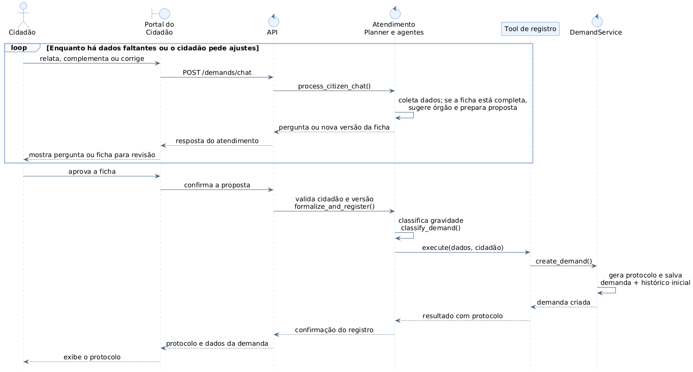

# GovResolve — Diagrama de Sequência

**Fluxo:** registrar uma reclamação pelo chat na versão local do protótipo. **Requisitos:** RF002, RF003, RF008, RF009, RF010 e RF016. **Pré-condição:** cidadão conectado e intenção de reclamação identificada; o caminho de orientação está no diagrama 04.

**Como explicar:** a ficha é construída com o cidadão e recebe uma sugestão de órgão quando houver informações suficientes. A revisão é um ciclo: cada correção pode gerar outra proposta. A aprovação pelo botão do portal inicia a formalização; em seguida, a IA classifica a gravidade e a ferramenta chama o serviço que salva a demanda e o histórico inicial.

`Tool de registro` corresponde a `DemandRegistrationTool`. `Atendimento` reúne a fachada `AIScreeningService`, `Planner`, `ConfirmationAgent`, `FormalizationAgent` e os especialistas para reduzir o número de participantes. O fragmento `loop` reúne a coleta inicial e as correções posteriores, que passam pelo mesmo endpoint de chat. A rota completa de confirmação é `/demands/chat/{session_id}/confirm`. A confirmação valida o proprietário da sessão e a versão informada, salva a mesma ficha apresentada e usa a unicidade da sessão para repetir o protocolo em confirmações duplicadas. Essas condições foram verificadas por testes isolados; o comportamento do modelo ao vivo não foi medido nesta revisão.
