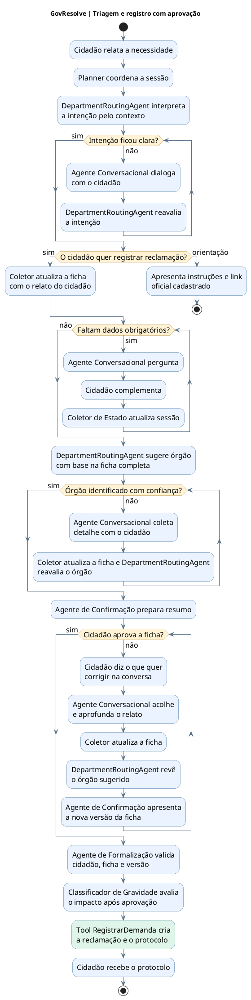

# GovResolve — Fluxo Multiagente e Ferramentas

**Versão:** protótipo local revisado em 28/10/2026; diferenças com a `main` remota na [conferência](06_conferencia.md).

**Foco:** triagem, decisão do cidadão e registro da demanda. **Requisitos:** RF002, RF006–RF010, RF016.

**Como explicar:** a IA primeiro identifica se a pessoa quer orientação ou quer reclamar. Orientação leva ao serviço oficial sem abrir protocolo. Na reclamação, a ficha vai sendo montada durante a conversa; só quando está completa a IA sugere o órgão. Se houver dúvida, pergunta e volta à ficha. O cidadão pode rejeitar a proposta e continuar conversando; só a aprovação aciona a formalização, a classificação de gravidade e a ferramenta de registro. O risco descrito fica na ficha para a triagem municipal, sem encaminhamento automático a um serviço de emergência.

**Fonte da prévia:** o SVG aprovado é gerado por Graphviz a partir de `04_multiagentes_tools.dot`, preservando a distribuição ajustada. O bloco PlantUML acima é uma representação editável equivalente do fluxo e pode ser distribuído de outra forma pelo renderizador. Como exceção ao fluxo principal mostrado, um pedido explícito de análise humana pode gerar uma ficha para revisão de destino pela Ouvidoria. O gestor então atribui o órgão na área de Gestão.

No SVG, `StateCollector` abrevia `DeterministicStateCollector`; a tool corresponde a `DemandRegistrationTool`, de nome `register_demand`. O classificador de gravidade é `SeverityClassificationAgent`.
