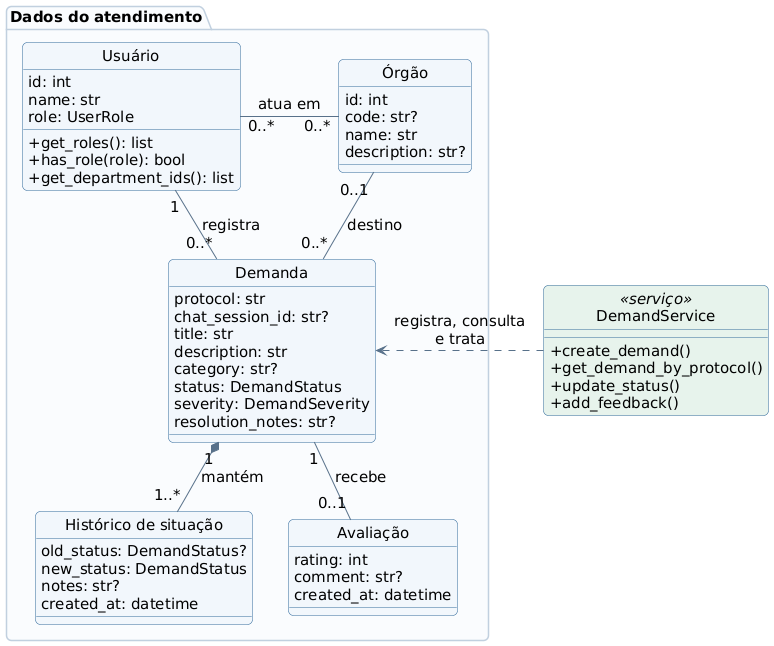
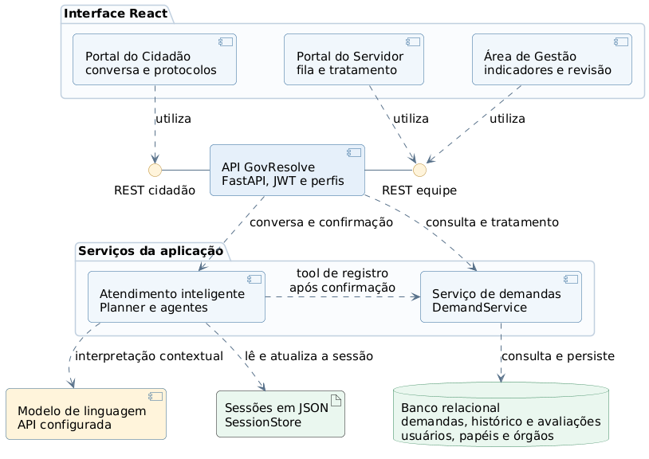
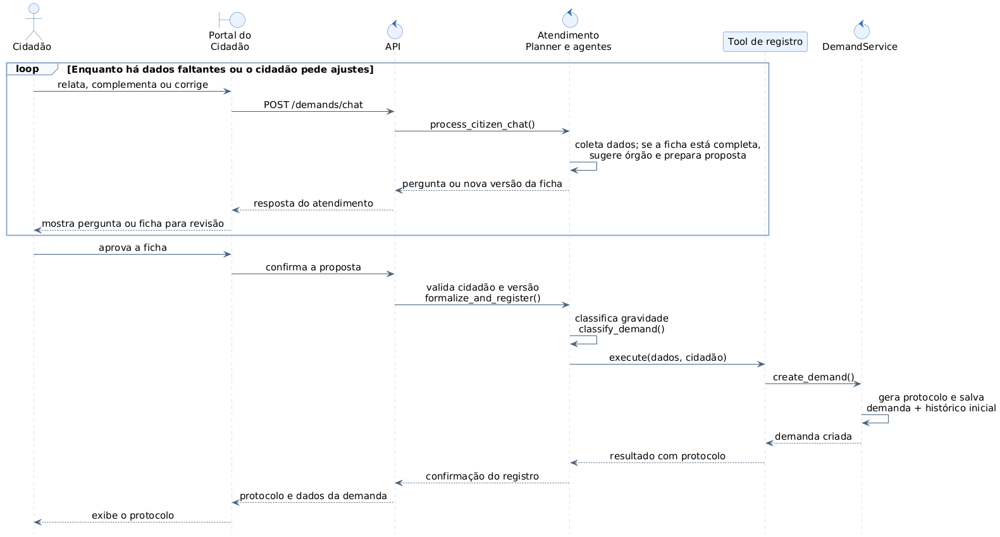
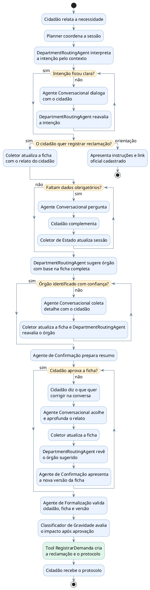

# GovResolve - Diagramas de Engenharia de Software

Grupo 10 - Ctrl+Z. Revisão em 28/10/2026. Repositório local atualizado sobre a `main` `8794ee39`, com melhorias locais ainda não publicadas. [Conferência](06_conferencia.md).

---

# GovResolve — Diagrama de Classes

**Foco:** entidades centrais, multiplicidades e operações reais. Revisado em 28/10/2026 para a versão local do protótipo; a diferença em relação ao GitHub está na [conferência](06_conferencia.md).

**Como explicar:** o usuário pode exercer vários papéis e atuar em vários órgãos. Cada demanda pertence a um cidadão, possui um destino opcional no modelo de dados, mantém histórico e pode receber uma avaliação. As operações de registro, atualização e avaliação pertencem a `DemandService`; as entidades ORM não implementam esses métodos.

| Nome no diagrama | Classe no código |
|---|---|
| Usuário | `User` |
| Órgão | `Department` |
| Demanda | `Demand` |
| Histórico de situação | `StatusHistory` |
| Avaliação | `Feedback` |

Os vínculos entre usuários e órgãos são mantidos por `user_departments`; os papéis adicionais, por `UserRoleAssignment`. O vínculo primário `User.department_id` foi preservado para compatibilidade com a versão publicada. Essas estruturas de apoio foram condensadas no desenho. A sessão fica em JSON por `SessionStore`; `Demand.chat_session_id` tem unicidade no banco, evitando dois protocolos para a mesma sessão. Demandas aprovadas para revisão humana podem permanecer sem órgão até o gestor atribuir o destino.

As operações aparecem com os parâmetros omitidos para leitura. Os atributos são uma seleção; `?` indica campo opcional. Estados: `ABERTO`, `EM ANDAMENTO` e `FECHADO`. Gravidade: `BAIXA`, `MEDIA`, `ALTA` ou `CRITICA`.

---

# GovResolve — Diagrama de Componentes

**Foco:** módulos ativos, interfaces HTTP e dependências da versão local do protótipo. Revisado em 28/10/2026; consulte a [conferência com o GitHub](06_conferencia.md).

**Como explicar:** os três ambientes usam a API. O atendimento inteligente monta a ficha e, depois da confirmação, usa `DemandRegistrationTool` para chamar `DemandService`. As conversas ficam em arquivos JSON; os registros e seus históricos ficam no banco relacional. Os círculos representam interfaces HTTP fornecidas pela API, não classes `IAtendimento` ou `ITratamento` existentes no código.

A autenticação e as dependências de autorização fazem parte da API. O login é demonstrativo, sem integração gov.br. A IA usa a API de modelo configurada. A revisão manual da Ouvidoria foi integrada à área de Gestão: o gestor consulta a fila sem órgão e atribui um destino pelas rotas administrativas. O envio de notificações por e-mail permanece removido.

| Interface fornecida | Rotas HTTP |
|---|---|
| REST cidadão | `/demands`: conversa, confirmação, protocolos e avaliação |
| REST equipe | `/admin`: fila, tratamento e revisão; `/management`: indicadores de gestão |

A autenticação usa `/auth`. A API e o serviço de demandas consultam os registros de usuários conforme as dependências de acesso; o desenho omite conexões de leitura repetidas para destacar o fluxo principal.

---

# GovResolve — Diagrama de Sequência

**Fluxo:** registrar uma reclamação pelo chat na versão local do protótipo. **Requisitos:** RF002, RF003, RF008, RF009, RF010 e RF016. **Pré-condição:** cidadão conectado e intenção de reclamação identificada; o caminho de orientação está no diagrama 04.

**Como explicar:** a ficha é construída com o cidadão e recebe uma sugestão de órgão quando houver informações suficientes. A revisão é um ciclo: cada correção pode gerar outra proposta. A aprovação pelo botão do portal inicia a formalização; em seguida, a IA classifica a gravidade e a ferramenta chama o serviço que salva a demanda e o histórico inicial.

`Tool de registro` corresponde a `DemandRegistrationTool`. `Atendimento` reúne a fachada `AIScreeningService`, `Planner`, `ConfirmationAgent`, `FormalizationAgent` e os especialistas para reduzir o número de participantes. O fragmento `loop` reúne a coleta inicial e as correções posteriores, que passam pelo mesmo endpoint de chat. A rota completa de confirmação é `/demands/chat/{session_id}/confirm`. A confirmação valida o proprietário da sessão e a versão informada, salva a mesma ficha apresentada e usa a unicidade da sessão para repetir o protocolo em confirmações duplicadas. Essas condições foram verificadas por testes isolados; o comportamento do modelo ao vivo não foi medido nesta revisão.

---

# GovResolve — Fluxo Multiagente e Ferramentas

**Versão:** protótipo local revisado em 28/10/2026; diferenças com a `main` remota na [conferência](06_conferencia.md).

**Foco:** triagem, decisão do cidadão e registro da demanda. **Requisitos:** RF002, RF006–RF010, RF016.

**Como explicar:** a IA primeiro identifica se a pessoa quer orientação ou quer reclamar. Orientação leva ao serviço oficial sem abrir protocolo. Na reclamação, a ficha vai sendo montada durante a conversa; só quando está completa a IA sugere o órgão. Se houver dúvida, pergunta e volta à ficha. O cidadão pode rejeitar a proposta e continuar conversando; só a aprovação aciona a formalização, a classificação de gravidade e a ferramenta de registro. O risco descrito fica na ficha para a triagem municipal, sem encaminhamento automático a um serviço de emergência.

**Fonte da prévia:** o SVG aprovado é gerado por Graphviz a partir de `04_multiagentes_tools.dot`, preservando a distribuição ajustada. O bloco PlantUML acima é uma representação editável equivalente do fluxo e pode ser distribuído de outra forma pelo renderizador. Como exceção ao fluxo principal mostrado, um pedido explícito de análise humana pode gerar uma ficha para revisão de destino pela Ouvidoria. O gestor então atribui o órgão na área de Gestão.

No SVG, `StateCollector` abrevia `DeterministicStateCollector`; a tool corresponde a `DemandRegistrationTool`, de nome `register_demand`. O classificador de gravidade é `SeverityClassificationAgent`.

---

# GovResolve — Matriz de Rastreabilidade

**Base:** requisitos e telas da versão local do protótipo, conferidos em 28/10/2026. A `main` do GitHub foi consultada no commit `8794ee39d1bbe4e5abe2162c8ccf2b5feb797149`; foi integrado ao repositório local, preservando as alterações do protótipo, conforme detalhado na [conferência](06_conferencia.md). Os diagramas representam a versão local preparada para apresentação.

| Requisito local | Elementos UML relacionados | Tela ou interação atual |
|---|---|---|
| **RF001 — Autenticação do cidadão** | 01: `Usuário`; 02: autenticação na `API GovResolve`; pré-condição de 03. | `LoginPage`: entrada demonstrativa por perfil. Integração gov.br ainda não implementada. |
| **RF002 — Registro de demanda** | 01: `Usuário`, `Demanda`, `DemandService.create_demand()`; 02: atendimento e serviço de demandas; 03 e 04. | Cidadão → “Nova demanda”: conversa, ficha e confirmação. |
| **RF003 — Geração de protocolo** | 01: `Demanda.protocol`; 03: retorno de `DemandService`; etapa final de 04. | Protocolo exibido depois do registro. |
| **RF004 — Acompanhamento da demanda** | 01: `Demanda`, `Histórico de situação`, `get_demand_by_protocol()`; 02: REST cidadão. | Cidadão → “Meus protocolos”: lista, filtros e detalhe da demanda. |
| **RF005 — Removido do escopo local** | Nenhum componente de notificações nos diagramas locais. | Atualizações consultadas na plataforma. O requisito ainda existe na `main` remota. |
| **RF006 — Identificação da forma de atendimento** | 02: `Atendimento inteligente`; 04: classificação de intenção por `DepartmentRoutingAgent`. | Chat distingue orientação de serviço e reclamação pelo contexto. |
| **RF007 — Orientação para autoatendimento** | 02: atendimento e modelo de linguagem; 04: saída de orientação sem protocolo. | Cartão com instruções e link do catálogo de serviços. |
| **RF008 — Classificação da demanda** | 01: `Órgão`, `Demanda.category`; 02: atendimento; 03 e 04: órgão sugerido com a ficha completa. | Ficha apresenta categoria e órgão sugerido antes de registrar. |
| **RF009 — Organização das informações** | 01: `Demanda.description`; 02: `SessionStore`; 03: revisão repetida da ficha; 04: coleta e correção. | Chat e cartão da ficha. “Não, quero ajustar” retoma a conversa. |
| **RF010 — Encaminhamento ao setor responsável** | 01: relação entre `Órgão` e `Demanda`; 02: serviço de demandas; 04: sugestão e registro do destino. | Protocolo mostra órgão; fila do servidor consulta demandas. O cidadão também pode pedir análise humana; a área de Gestão contém a fila de revisão e a atribuição do órgão. |
| **RF011 — Consulta das demandas pelo servidor** | 01: usuário e vínculos com órgãos; 02: Portal do Servidor, REST equipe e serviço de demandas. | `ServerPanel` / `DemandQueue`: fila, filtros, prioridade e paginação. |
| **RF012 — Atualização do status** | 01: `Demanda.status`, `Histórico de situação`, `DemandService.update_status()`; 02: REST equipe. | Ações da fila: `ABERTO → EM ANDAMENTO → FECHADO`. |
| **RF013 — Controle de acesso** | 01: `Usuário.get_roles()`, `has_role()`, vínculos com órgãos; 02: JWT e perfis na API. | Ambientes de cidadão, servidor e gestão. Sessões privadas, perfis explícitos e escopo por órgão. O login acadêmico não equivale à integração gov.br. |
| **RF014 — Registro da conclusão** | 01: `Demanda.resolution_notes`, histórico e `update_status()`; 02: serviço de demandas. | `DemandCloseModal`: parecer obrigatório ao fechar; cidadão consulta o resultado em “Meus protocolos”. |
| **RF015 — Avaliação do atendimento** | 01: `Avaliação`, vínculo com `Demanda`, `DemandService.add_feedback()`; 02: REST cidadão. | Detalhe de demanda fechada: nota e comentário. |
| **RF016 — Classificação de Gravidade por IA pós-aprovação humana** | 01: `Demanda.severity`; 02: atendimento e modelo; 03 e 04: gravidade antes da tool e depois da confirmação. | Gravidade e justificativa retornam no registro e aparecem nos detalhes e filtros. O catálogo não estabelece SLA oficial. |

## Requisitos não funcionais

| Requisito | Relação com o material | Limite da conferência |
|---|---|---|
| RNF001 — Proteção de dados pessoais | Autenticação, perfis e vínculos de atendimento. | O desenho não certifica segurança ou conformidade LGPD. A integração incluiu verificações de sessão, versão e isolamento de órgãos; não é uma certificação de segurança ou LGPD. |
| RNF002 — Acessibilidade | Imagens opacas, texto escuro, fontes legíveis e informações além de cores. | Acessibilidade completa do aplicativo não foi avaliada nesta revisão. |
| RNF003 — Tempo de confirmação do registro | Resposta final da sequência 03. | Meta de requisito; o caminho mostrado aguarda IA e persistência. Latência inferior a 3 segundos não foi comprovada. |
| RNF004 — Disponibilidade | Infraestrutura da aplicação. | Meta de 99,9%; não comprovada pelos diagramas. |
| RNF005 — Removido do escopo local | Ausência de envio de e-mail nos desenhos locais. | A `main` ainda mantém notificações. |
| RNF006 — Confiabilidade do encaminhamento | Validação do órgão cadastrado e vínculo da demanda. | Fila manual e atribuição pelo gestor foram integradas à versão local. |
| RNF007 — Fidelidade das informações da IA | Coleta factual e revisão pelo cidadão em 03/04. | A conferência do fluxo não mede a qualidade das respostas do modelo. |
