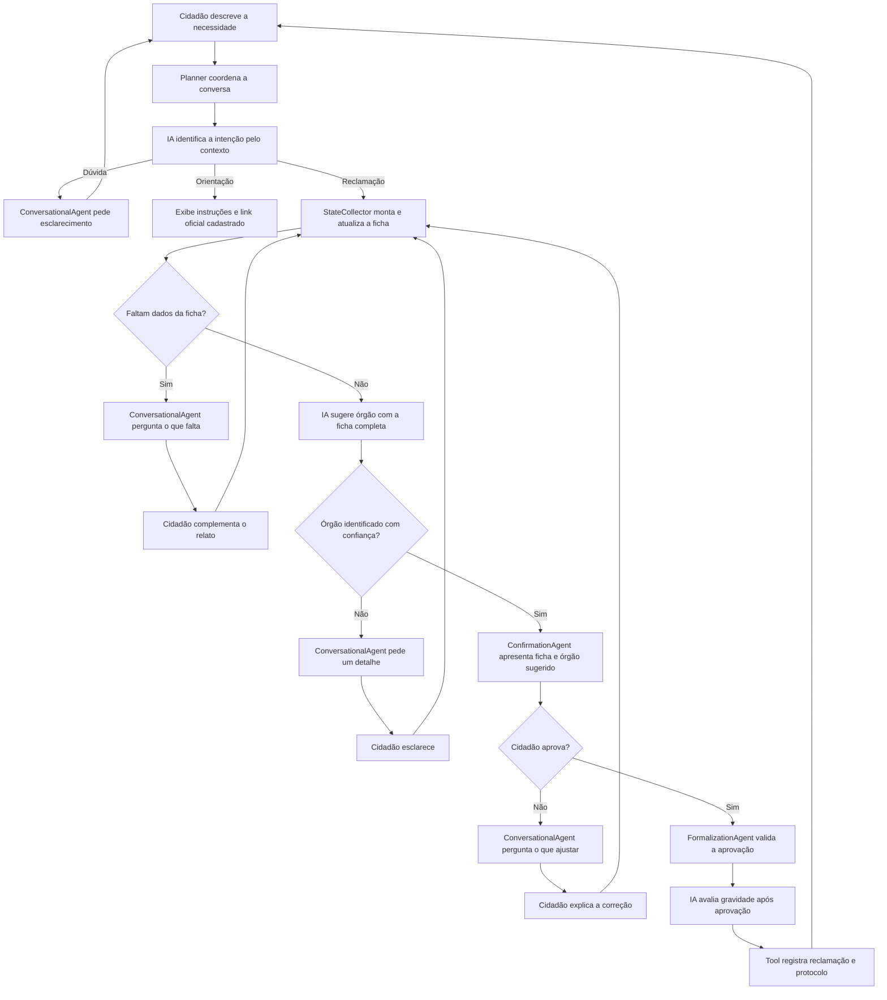

# Arquitetura do Sistema GovResolve

## 1. Visão Geral

O **GovResolve** é uma solução para gestão, triagem inteligente e acompanhamento de demandas e reclamações dos cidadãos perante a administração pública. O sistema é estruturado no modelo de **Arquitetura Modular / Clean Architecture**, separando camadas de apresentação, serviços de negócio, persistência e inteligência artificial.

```
+-------------------------------------------------------------------+
|                        Frontend (Vite + React)                    |
|       Portal do Cidadão (Acessível)  |  Painel do Servidor        |
+---------------------------------+---------------------------------+
                                  | REST API / JSON
+---------------------------------v---------------------------------+
|                       Backend (FastAPI)                           |
|  +--------------------+  +--------------------+  +--------------+ |
|  |     API Routes     |  |    Domain Services |  |  AI Module   | |
|  | (Auth, Demands,    |  | (Lifecycle, RBAC,  |  | (Screening,  | |
|  |  Feedback, Admin)  |  |  Protocol, Notify) |  |  Summarizer) | |
|  +--------------------+  +--------------------+  +--------------+ |
|                                 |                                 |
|  +-------------------------------------------------------------+  |
|  |                   Database Layer (SQLAlchemy)               |  |
|  +-------------------------------------------------------------+  |
+---------------------------------+---------------------------------+
                                  |
               +------------------+------------------+
               |                                     |
    +----------v----------+               +----------v----------+
    | PostgreSQL / SQLite |               | Google Gemini API   |
    +---------------------+               +---------------------+
```

---

## 2. Estrutura de Diretórios e Responsabilidades

Conforme o guia de **Arquitetura de Repositórios**:

- **`src/`**: Núcleo da aplicação backend.
  - **`api/`**: Camada de transporte HTTP, rotas, contratos de entrada e saída (Pydantic DTOs), dependências de injeção (RBAC, sessões) e middlewares.
  - **`services/`**: Casos de uso e lógica de negócio central (geração de protocolo único e transições de status da demanda).
  - **`ai/`**: Integração com modelos generativos (Gemini), prompts versionados e rotinas de extração estruturada sem alucinação.
  - **`db/`**: Modelos de entidades relacionais (SQLAlchemy), conexão e migrations (Alembic).
  - **`config.py`**: Configurações centralizadas tipadas com pydantic-settings.
  - **`main.py`**: Ponto de entrada do executável.

- **`frontend/`**: Aplicação de interface com usuário.
  - **`src/components/`**: Componentes reutilizáveis focados em acessibilidade (WCAG 2.1 AA).
  - **`src/pages/`**: Páginas do Cidadão (Registro, Consulta, Autoatendimento) e Servidor (Gestão de Demandas).
  - **`src/services/`**: Clientes de comunicação com a API backend.
  - **`public/`**: Assets estáticos e identidade visual do GovResolve.

- **`infra/`**: Configurações operacionais e empacotamento.
  - Contém `requirements.txt`, Dockerfiles (`Dockerfile`, `Dockerfile.frontend`) e receitas de inicialização.

- **`tests/`**: Testes automatizados.
  - **`unit/`**: Testes de regras de negócio isoladas (máquina de estados, validações).
  - **`integration/`**: Testes de rotas da API, persistência e autenticação.

- **`docs/`**: Documentação técnica, requisitos, backlog e elicitação do projeto.

---

## 3. Máquina de Estados da Demanda (RF012)

O ciclo de vida da demanda é estritamente controlado pela aplicação, sendo permitidas apenas as transições a seguir por servidores autorizados:

```
[ REGISTRO ]
     |
     v
 +--------+      Servidor assume atendimento      +--------------+      Servidor registra parecer      +---------+
 | ABERTO | ----------------------------------->  | EM ANDAMENTO | --------------------------------->  | FECHADO |
 +--------+                                       +--------------+                                     +---------+
```

- Tentativas de salto de estado inválido (ex: ABERTO direto para FECHADO sem justificativa ou recuo de status) são barradas pelo modelo de domínio.
- A conclusão exige obrigatoriamente o preenchimento de `resolution_notes` (RF014).

---

## 4. Arquitetura Multiagente e Execução de Tools (Human-in-the-Loop)

O GovResolve adota um pipeline conversacional multiagente coordenado pelo **Planner**, garantindo separação estrita de responsabilidades, diálogo humanizado e persistência relacional controlada por Tools:

```
[ Cidadão ]
    |
    v
+-----------------------------------------------------------------------------------------+
| Planner (PlannerAgent)                                                                  |
|                                                                                         |
| 1. Classifica a intenção pelo contexto                                                   |
|    - Orientação segue ao serviço oficial sem abrir protocolo                             |
|    - Reclamação inicia uma ficha progressiva, sem escolher órgão ainda                   |
|                                                                                         |
| 2. Aciona DeterministicStateCollector                                                    |
|    - Extrai dados factuais sem alucinações (endereço, cruzamento, ponto de referência)   |
|    - Atualiza a ficha de reclamação da sessão persistente                               |
|                                                                                         |
| 3. Quando a ficha está completa, DepartmentRoutingAgent sugere órgão do catálogo        |
|    - Se houver dúvida, ConversationalAgent pergunta e o fluxo retorna à ficha            |
| 4. ConfirmationAgent apresenta ficha e órgão para aprovação ou revisão em conversa       |
+-----------------------------------------------------------------------------------------+
    |
    v (Apresentação da Proposta Estruturada para Aprovação Cidadã)
[ Aprovação Humana: 'Confirmar e Gerar Protocolo' ]
    |
    v
+-----------------------------------------------------------------------------------------+
| FormalizationAgent                                                                      |
|                                                                                         |
| 1. Valida a aprovação da ficha e do órgão sugerido                                      |
| 2. Classificação de Gravidade Operacional (CRÍTICA, ALTA, MÉDIA, BAIXA)                 |
| 3. Execução da Tool de Persistência no Banco de Dados ('DemandRegistrationTool')        |
|    - Gera Protocolo Único Municipal (GR-YYYYMMDD-XXXX em <3s)                           |
|    - Registra Demand com status ABERTO e histórico inicial                              |
| 4. Retorno ao Chat com Protocolo e Card de Acompanhamento em Tempo Real                 |
+-----------------------------------------------------------------------------------------+
```

### Fluxo da mensagem, em termos simples



- **Planner:** conduz a sequência de cada mensagem.
- **DepartmentRoutingAgent:** primeiro distingue orientação de serviço e reclamação. Para reclamação, só sugere um órgão depois que a ficha está completa; opções e confiança são validadas contra os catálogos locais.
- **RequirementsAgent:** mantém apenas o reconhecimento estrito de saudações, por compatibilidade; não classifica o assunto.
- **StateCollector:** aproveita o que o cidadão já escreveu e atualiza a ficha.
- **ConversationalAgent:** conversa e pergunta os dados que ainda faltam.
- **ConfirmationAgent:** apresenta o resumo para o cidadão revisar e confirmar.
- **FormalizationAgent:** após a confirmação, prepara a demanda e aciona a gravação.
- **SeverityAgent:** estima a prioridade operacional.
- **DemandRegistrationTool:** registra a solicitação e gera o protocolo.

As chamadas generativas usam `AI_PROVIDER=openai` e `OPENAI_MODEL=gpt-6-luna` por padrão. Para testes, `AI_PROVIDER=omniroute` seleciona a lista `OMNIROUTE_MODELS`, que continua configurada.

O `DepartmentRoutingAgent` separa duas decisões: reconhecer a intenção no começo da conversa e sugerir o órgão apenas com a ficha completa. A sugestão só pode usar códigos cadastrados; não há fallback por palavras-chave. Os links e instruções de autoatendimento são conteúdo curado em `SELF_SERVICE_OPTIONS`; a IA decide qual opção se aplica, mas não cria links. Quando há dúvida, o `ConversationalAgent` pede esclarecimento e o fluxo retorna à ficha ou à etapa de roteamento. A descrição do risco permanece no relato para triagem municipal; o chat não encaminha automaticamente a serviços de emergência. A gravidade é avaliada por IA após aprovação e, se indisponível, fica marcada como provisória para revisão humana.
