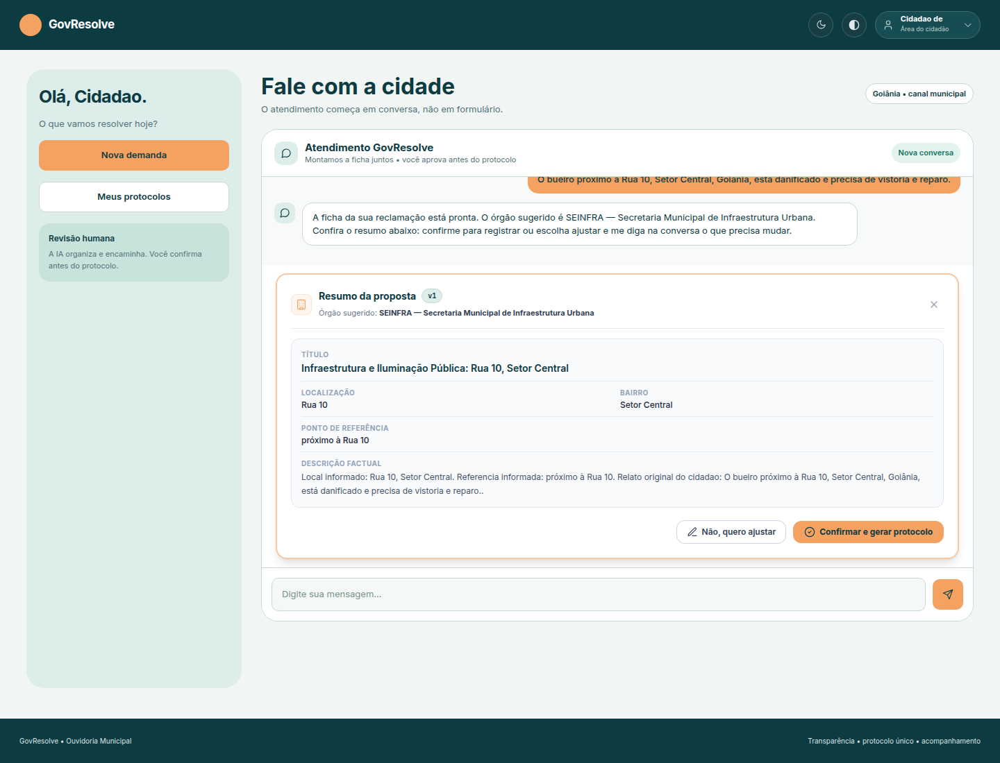
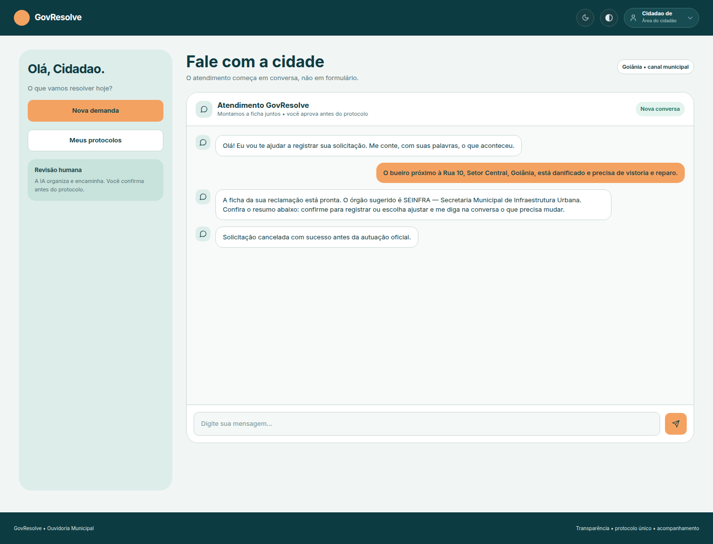

# CT-07 — Cancelar proposta antes de registrar

**Resultado: APROVADO.** 5/5 critérios atendidos. Uma execução, uma sessão, sem repetição para alterar o resultado.

Execução: 2026-11-17T06:51:51.039576+00:00 a 2026-11-17T06:51:56.081795+00:00 (UTC). Ambiente GovResolve local, commit `8e058e8`, cidadão demonstrativo, SQLite e memória isolados. Relato, identidade demonstrativa e dados são fictícios. O runner não leu nem alterou o `.env` e não expôs segredos. Nenhum código da aplicação foi alterado; nenhum commit ou push foi realizado.

## Base e dados

- `docs/atividades/checkpoint3-testes-funcionais/04_oito_casos_finais.md`, CT-07.
- `docs/especificacao-requisitos.md`: RF002, RF003 e HU002.
- `frontend/src/components/chat/ProposalCard.tsx`: botão X com title Cancelar esta solicitação antes da autuação.
- `docs/apresentacao/diagramas/03_sequencia.md`: formalização exige aprovação da ficha.

> O bueiro próximo à Rua 10, Setor Central, Goiânia, está danificado e precisa de vistoria e reparo.

O esperado é que a desistência anterior à aprovação não gere demanda nem protocolo. Nenhum texto literal, limpeza de sessão ou retomada foi imposto como requisito.

## Passos e resultado esperado versus observado

| Passo | Ação | Esperado | Observado | Evidências |
|---|---|---|---|---|
| 1 | Abrir contexto novo e entrar no portal como cidadão demonstrativo | Atendimento novo em ambiente de testes. | Portal local acessível; banco isolado com 110 demandas e 135 históricos pré-existentes. | [01-inicio.png](01-inicio.png), [before-db.json](database-summary.json) |
| 2 | Enviar relato fictício de bueiro danificado pela UI | Proposta para revisão, completando apenas o necessário se solicitado. | Proposta v1 já na primeira resposta; nenhum complemento; duas chamadas reais de IA HTTP 200. | [chat-01.json](evidence.json), [chat-01.png](chat-01.png), [backend-excerpt.log](evidence.json) |
| 3 | Capturar identificador, sessão e ausência de demanda antes de cancelar | Proposta ainda não aprovada e sem protocolo. | AWAITING_CONFIRMATION; approved_proposal_version/formalized_protocol/registered_protocol nulos; zero linha pelo session_id. | [pre-cancellation-session.json](evidence.json), [pre-cancellation-session-demands.json](evidence.json), [pre-cancellation.png](pre-cancellation.png) |
| 4 | Acionar X com title Cancelar esta solicitação antes da autuação | Não formalizar a reclamação. | POST /cancel retornou HTTP 200/CANCELLED em 0.06 s; mensagem de cancelamento apareceu. | [events.json](events.json), [http.json](http-summary.json), [cancellation.json](http-summary.json), [post-cancellation.png](post-cancellation.png) |
| 5 | Conferir UI, GET da sessão, memória e SQLite isolado após a desistência | Sem confirmação de registro, protocolo ou demanda da sessão. | Ausência confirmada nas evidências; sessão CANCELLED e zero demanda vinculada; totais 110/135 inalterados. | [post-cancellation-ui.txt](post-cancellation-ui.txt), [post-cancellation-get-session.json](evidence.json), [post-cancellation-session-from-recorded-id.json](evidence.json), [post-cancellation-session-demands.json](evidence.json), [after-db.json](database-summary.json) |
| 6 | Encerrar contexto/navegador e consolidar registro local | Execução serial encerrada antes do próximo caso. | Runner standalone exit 0; nenhuma exceção; recursos do navegador fechados pelo helper. | [events.json](events.json), [execution.json](result.json) |

## Critérios verificados

| Critério | Resultado | Esperado versus observado |
|---|---|---|
| Proposta exibida e ainda não aprovada antes do cancelamento | PASSOU | Ficha para revisão sem registro anterior. → Proposta v1 no primeiro turno; AWAITING_CONFIRMATION; versão aprovada e protocolos nulos; zero demanda da sessão. |
| Cancelamento acionado pelo botão X da proposta | PASSOU | Ação de desistência tratada pelo fluxo antes da autuação. → Clique no botão com title Cancelar esta solicitação antes da autuação; POST /cancel HTTP 200; success=true, state=CANCELLED; mensagem correspondente visível. |
| Interface não confirma registro nem exibe protocolo após cancelar | PASSOU | Sem confirmação de registro ou protocolo da proposta cancelada. → Tela e texto conferidos: mensagem de cancelamento; nenhum cartão de confirmação ou identificador de protocolo. Referências genéricas à palavra protocolo na navegação não constituem geração. |
| Sessão cancelada sem protocolo formal ou aprovação | PASSOU | Desistência não formaliza a ficha nem gera protocolo. → Memória da sessão: CANCELLED, is_ready_to_register=false, protocolos e versão aprovada nulos. GET da mesma sessão HTTP 200/CANCELLED. Nenhuma requisição POST /confirm. |
| Nenhuma demanda ou histórico novo no banco isolado | PASSOU | Ausência de formalização da proposta cancelada. → Demandas 110→110; históricos 135→135; consulta SQL pelo session_id retornou zero linha antes e depois. |

## Métricas

| Métrica | Valor |
|---|---:|
| Turnos / complementos | 1 / 0 |
| Tempo total de chat observado | 2.869s |
| Requisição de cancelamento observada | 0.06s |
| Chamadas reais de IA HTTP 200 | 2 |
| Novas demandas | 0 |
| Demandas antes → depois | 110 → 110 |
| Históricos antes → depois | 135 → 135 |
| Demandas vinculadas à sessão antes → depois | 0 → 0 |
| Critérios atendidos | 5/5 |

Os tempos são medições desta execução e não critérios de SLA. O cancelamento não produziu nova chamada à IA; as duas chamadas ocorreram na preparação da proposta.

## Problemas e limitações

Nenhum problema funcional ou erro auxiliar foi encontrado no escopo executado. O `GET` e o arquivo de memória conservam a proposta com estado `CANCELLED`; isso não descumpre o caso, que não define remoção dos dados nem retomada.

- Uma execução real em uma sessão e proposta; não mede robustez estatística da IA.
- Não se exige uma mensagem literal, remoção completa dos dados da sessão ou possibilidade de retomada: esses comportamentos não foram definidos no CT-07.
- A UI retirou o cartão e limpou a chave ativa do sessionStorage; a memória e o GET conservaram a proposta com estado CANCELLED. São observações sem reprovação, conforme a pendência delimitada do caso.
- Não foi tentada confirmação, retomada ou nova conversa após cancelar; estão fora deste caso.
- As duas chamadas reais de IA HTTP 200 são evidenciadas pelos logs naturais do backend; sem mock, monkeypatch, alteração de código ou nova instrumentação.
- Limite operacional de seis complementos não foi utilizado: a primeira resposta já produziu proposta completa.

## Evidências e rastreio

Sessão: `[ID de sessão omitido]`; proposta `proposal_e21f907e1679`, versão 1. Protocolos `formalized_protocol` e `registered_protocol`, além da versão aprovada, permaneceram nulos. Nenhuma requisição `/confirm` foi enviada.

O [resultado estruturado](result.json) enumera todas as evidências. [resumo HTTP sem tokens ou corpos de relato](http-summary.json), [eventos](events.json), [execução](result.json), [recorte do backend](evidence.json), [sessão posterior](evidence.json) e [consulta SQL posterior](evidence.json) permitem revisar a conclusão.
