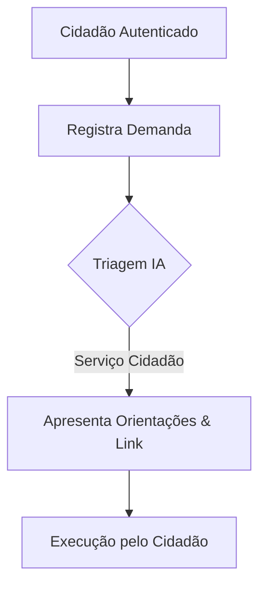
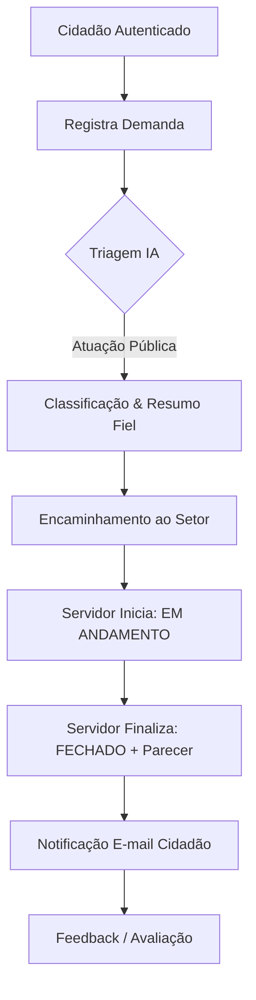

# Priorização do Backlog (Método MoSCoW)

**Projeto:** GovResolve-MVP  
**Equipe:** Grupo 10 (Ctrl+Z)

---

## 1. Priorização Consolidada

| Categoria MoSCoW | Histórias de Usuário | Requisitos Funcionais | Requisitos Não Funcionais |
|---|---|---|---|
| **Must Have (Obrigatório)** | HU001, HU002, HU003, HU004, HU005, HU007, HU008, HU009, HU010, HU011, HU012 | RF001, RF002, RF003, RF004, RF005, RF006, RF007, RF008, RF009, RF010, RF011, RF012, RF013, RF014 | RNF001, RNF002, RNF005, RNF006, RNF007 |
| **Should Have (Desejável)** | HU006 | — | RNF003, RNF004 |
| **Could Have (Possível)** | HU013 | RF015 | — |
| **Won't Have (Não Será Feito)** | — | *Ver seção de exclusões abaixo* | — |

---

## 2. Exclusões Formais de Escopo (Won't Have)

Com o objetivo de assegurar a integridade do processo público, governança e conformidade legal, as seguintes premissas foram definidas como **fora de escopo** para o MVP:

1. **Tratativa da demanda realizada exclusivamente pela IA:** A IA não substitui o julgamento ou ato administrativo do servidor.
2. **Decisão autônoma da IA sobre a resolução:** A IA pode organizar dados e sugerir direcionamento, mas a solução final cabe ao setor público.
3. **Execução de procedimentos administrativos pela IA:** A IA não emite atos, penalidades ou ordens de serviço.
4. **Alteração de status pela IA:** A transição `ABERTO → EM ANDAMENTO → FECHADO` é prerrogativa exclusiva do servidor responsável.
5. **Fechamento ou conclusão automática pela IA:** Apenas servidores autorizados registram o parecer e finalizam a demanda.
6. **Geração de documentos formais de resolução:** Não faz parte do MVP produzir laudos ou certidões jurídicas pela IA.
7. **Registro ou envio anônimo / não autenticado:** Usuários devem estar autenticados (Gov.br) para registrar e acompanhar demandas.

---

## 3. Síntese dos Dois Fluxos Principais

### Fluxo A: Autoatendimento

### Fluxo B: Atendimento Público

